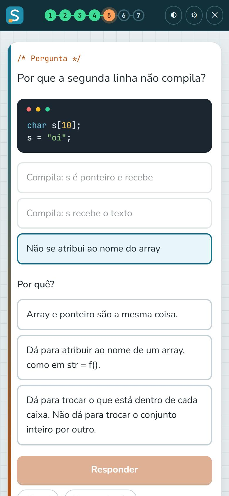
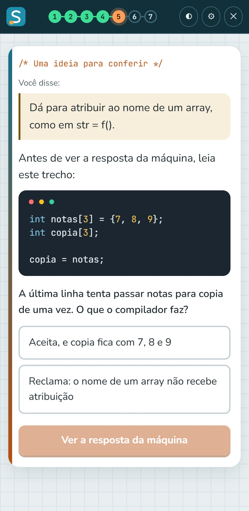
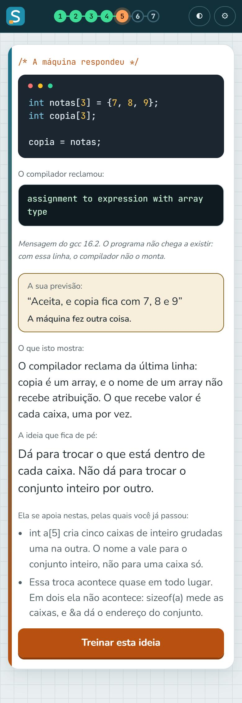
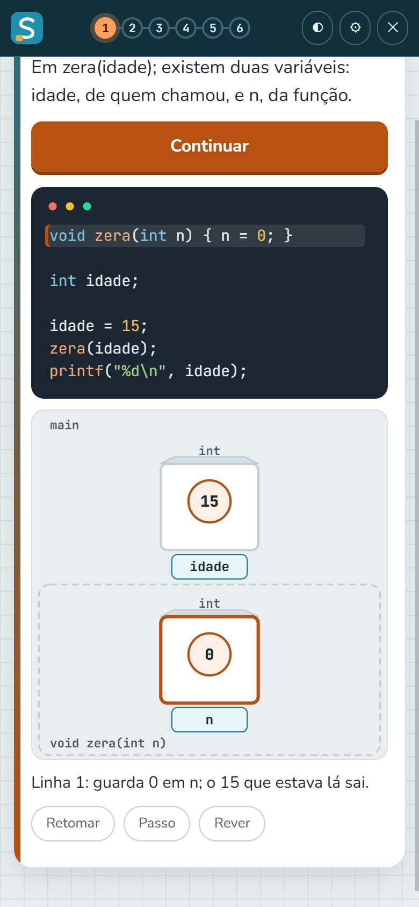

# Structura

Sistema adaptativo para **detectar e corrigir concepções errôneas sobre
ponteiros na linguagem C**.

Uma resposta errada, sozinha, não diz se a pessoa não sabe o conteúdo ou
se sustenta uma ideia errada com convicção. O Structura pergunta **a
resposta, a razão da resposta e a certeza**, formula daí uma hipótese
sobre o que a pessoa pensa e escolhe o que fazer: seguir em frente,
reforçar, ensinar passo a passo ou **mostrar, depois de a pessoa prever,
o que o compilador de fato faz**.

Trabalho de Conclusão de Curso de Rafael Henrique dos Santos Simão,
Sistemas de Informação, Universidade Federal de Viçosa, *Campus* Rio
Paranaíba, 2026.

<p align="center">
  
  
  
  
</p>

## Em números

| | |
| --- | --- |
| tópicos | **13**, da declaração de variáveis ao ponteiro pendente por escopo |
| premissas | **79**, organizadas em um grafo por tópico |
| concepções errôneas | **61**, cada uma com a procedência declarada: 57 conferidas na obra citada e 4 hipóteses declaradas como tais |
| questões de diagnóstico | **560** |
| passos de ensino | **402**, em 13 escadas, cada passo com duas versões |
| demonstrações com previsão | **80** |
| cenas animadas | **79** |
| testes automatizados | **7 556** |

## Como funciona uma sessão

Cada tópico é um conjunto de premissas, proposições curtas que a pessoa
pode afirmar ou negar. Para cada premissa, o sistema faz uma pergunta e
pede três coisas: a resposta, a razão e a certeza. A combinação decide o
caminho:

| Resposta, razão e certeza | Situação | O que o sistema faz |
| --- | --- | --- |
| resposta certa, razão certa e "tenho certeza" | sabe | segue para a próxima premissa |
| resposta certa sem certeza, ou sinais que não combinam | acerto sem firmeza | faz mais uma pergunta, em outro formato |
| "Não sei", ou resposta errada com "chutei" | não sabe | ensina a premissa em uma **escada de passos** curtos |
| resposta errada, pela razão de uma concepção errônea, com alguma certeza | sustenta uma concepção errônea | abre a **demonstração com previsão** |

Na demonstração, a tela **"Você disse"** devolve à pessoa a ideia que
ela afirmou e pede uma previsão sobre um programa curto. A tela **"A
máquina respondeu"** mostra o que o compilador ou a execução fizeram, e
qual premissa fica de pé. Ao fim do tópico, o sistema volta às premissas
trabalhadas com uma pergunta nova e mostra o **fechamento**: as ideias
erradas encontradas, as lacunas e o que já estava firme.

A situação atribuída é uma **hipótese diagnóstica**: o sistema reconhece
um padrão de resposta, e não constata o que a pessoa pensa.

## Rodar

Python 3.11 ou mais novo (desenvolvido em 3.14.7).

```bash
python -m pip install -r requirements.txt
python -m mvp.portal
```

Abra **http://127.0.0.1:8010**. A página inicial mostra o caminho dos 13
tópicos; cada um abre a sua trilha.

Com Docker, o sistema sobe e fica ligado:

```bash
docker compose up -d --build
```

Para analisar as sessões gravadas, o exportador gera três tabelas em CSV
(sessões, premissas e respostas), pelo código do participante:

```bash
python -m mvp.exporta_trilha --pasta coleta/portal --out analise/trilha
```

No Windows, `iniciar-structura.bat` e `parar-structura.bat` fazem o mesmo
com dois cliques. O sistema atende só na própria máquina (`127.0.0.1`):
não tem login.

## O que torna o conteúdo conferível

A ideia central do trabalho é que **o material de ensino seja testado
contra o programa que ele descreve**, e não contra a lembrança de quem o
escreveu.

- **O compilador é o juiz.** Toda afirmação sobre o comportamento de um
  programa em C é conferida compilando e executando o trecho: a linha
  que um passo chama de certa compila, a que ele chama de inválida é
  recusada, e a saída é a que o texto diz.

  ```bash
  python scripts/confere_escada.py kc_07   # passos, exemplos e demonstrações de um tópico
  python scripts/confere_banco.py          # as questões de prever a saída
  ```

- **O catálogo declara de onde veio.** Cada concepção errônea traz a
  obra, a página ou o item, e um grau de procedência. O documento
  [docs/curadoria-crencas.md](docs/curadoria-crencas.md) é gerado do
  catálogo e diz, linha por linha, o que foi conferido na obra.
- **Estudantes simulados** percorrem os 13 tópicos em dez perfis fixos
  de resposta, para medir o tamanho de cada percurso e garantir que toda
  sessão termina.
- **A suíte de testes** reúne tudo isso:

  ```bash
  python -m pytest -q
  ```

  São 7 556 testes, cerca de 35 minutos. Na versão descrita na
  monografia (commit `16d448b`, de 23/11/2026), 7 548 passaram e 8 são
  dispensados por construção.

Os conferidores e boa parte dos testes precisam do **gcc**. O trabalho
usou o gcc 16.2 (MinGW-W64) no Windows; a variável `STRUCTURA_GCC` aponta
para o compilador em outra máquina. O sistema em si roda sem compilador:
o conteúdo já chega conferido.

## O que este trabalho não afirma

- **Não foi avaliado com estudantes.** Nada aqui é sobre aprendizagem
  medida. O protocolo do estudo está pronto (Apêndice A da monografia) e
  é o primeiro dos trabalhos futuros.
- **A adequação pedagógica depende do estudo com estudantes.** O
  conteúdo foi lido e validado pelo autor e conferido por compilador no
  que o compilador alcança.
- **A conferência vale para um ambiente**: o gcc 16.2 no Windows.
- **Quatro concepções do catálogo são hipóteses**, declaradas como tais.

O sistema foi construído com assistência de inteligência artificial
generativa (Claude Code, da Anthropic), sob a direção do autor. O uso
está declarado na monografia, e o histórico de versões identifica cada
alteração feita com essa assistência.

## Mapa do repositório

| Pasta | O que é |
| --- | --- |
| **`mvp/`** | o sistema: o motor da sessão (`trilha.py`, `motor.py`), o servidor (`portal.py`, `trilha_app.py`), as páginas (`web/`) e os testes (`test_*.py`) |
| **`mvp/dominio/`** | o conteúdo, em YAML: os grafos de premissas, o catálogo de concepções (`beliefs_kcNN.yaml`), o banco de questões (`activities_kcNN.yaml`) e as escadas (`escada_kcNN.yaml`) |
| **`scripts/`** | os conferidores e os geradores: o oráculo do compilador, o conferidor das escadas e do banco, os estudantes simulados, a curadoria, o LaTeX e as figuras da monografia |
| **`docs/`** | o registro do projeto: especificações, planos, a curadoria e o texto de leitura de cada escada (`escada-kcNN-leitura.md`) |
| **`docs/monografia/`** | o texto do TCC: as seções em Markdown, o LaTeX gerado, as figuras e as pendências |
| `candidatos/` | material proposto antes de entrar no domínio |
| `api/` `engine/` `store/` `tools/` `tests/` `domain/` `prototipo/` `web/` | a geração anterior do sistema, de setembro de 2026, mantida como histórico |

Para ler o conteúdo de ensino sem abrir o sistema, comece por
[docs/escada-kc07-leitura.md](docs/escada-kc07-leitura.md) (ponteiro e
array).

## A monografia

As seções estão em `docs/monografia/*.md`. O PDF é gerado delas:

```bash
python scripts/monografia_latex.py
cd docs/monografia/latex
pdflatex TCC_STRUCTURA && bibtex TCC_STRUCTURA && pdflatex TCC_STRUCTURA && pdflatex TCC_STRUCTURA
```

Os números que o texto afirma sobre o sistema são conferidos por teste
(`mvp/test_monografia.py`, `mvp/test_procedencia.py`): se o sistema muda
e o texto não, o teste falha.

## Privacidade

O trabalho não coletou dados de participantes. As sessões que o sistema
grava ficam em pastas fora do controle de versão (`ensaios/`, `coleta/`),
e o protocolo do estudo futuro identifica cada participante por um
código anônimo: nome e matrícula não entram no sistema.

## Licença

O código e o conteúdo de ensino do Structura estão sob a licença MIT
(arquivo [LICENSE](LICENSE)). Ficam fora dela, por terem dono ou licença
própria:

- as fontes tipográficas em `mvp/web/fontes/`, sob a SIL Open Font
  License (as licenças estão na mesma pasta);
- os arquivos de estilo do LaTeX em `docs/monografia/latex/`
  (`abntex2-UFV.sty` e `abntex2-alf-tcc.bst`), sob a LaTeX Project Public
  License;
- o texto da monografia, em `docs/monografia/`, que é o Trabalho de
  Conclusão de Curso do autor e não é licenciado para reuso;
- os trechos de obras de terceiros citados no catálogo e nos documentos,
  que pertencem aos respectivos autores.
