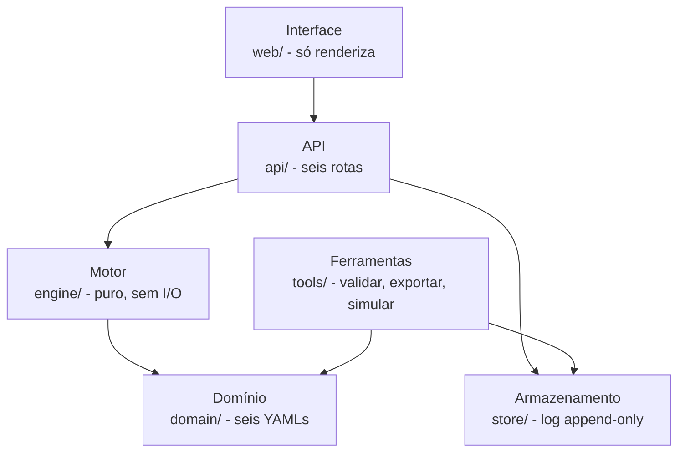
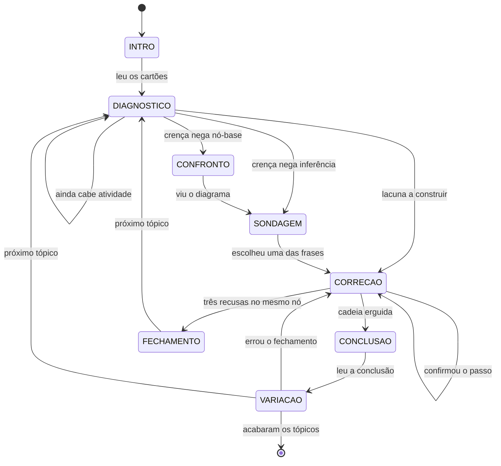

# Arquitetura

Como o sistema está construído, por que assim, e onde encostar a mão para
mudar cada coisa. 7.645 linhas de Python, 252 testes, domínio declarativo em
seis arquivos YAML.

## Visão em camadas

Cinco camadas, e a regra que organiza tudo: **as setas só apontam para
baixo**. O motor não conhece o banco, o domínio não conhece o motor, a
interface não decide nada.

**O motor é puro.** Não importa `store`, não toca disco, não sorteia, não
consulta relógio. Ele recebe `(domínio, estado, evento)` e devolve `(estado
novo, próxima ação, eventos a gravar)`. É o que permite rodar uma sessão
inteira num teste, sem HTTP e sem banco — e reproduzi-la na defesa, ao vivo,
sem depender de nada.

**A interface não tem regra.** O servidor devolve a próxima ação e o
navegador desenha. Não existe no JavaScript: escolha de atividade, avaliação
de acerto, decisão entre braços, ou qualquer texto de domínio. Isso importa
para o experimento: um braço não pode divergir do outro por acidente de
implementação no front.

**O domínio é dado, não código.** Seis arquivos YAML: tópicos, grafos de
premissas, crenças, atividades, feedback e introdução. Um sétimo arquivo,
`study.yaml`, guarda o que é decisão do **estudo** e não do conteúdo: quais
tópicos entram, quantas atividades por tópico, a escala de confiança, os
termos de nomeação tardia.

## Módulos

| Módulo | Responsabilidade | Sabe de C? |
| --- | --- | --- |
| `engine/loader.py` | carrega e valida os YAMLs; único ponto do motor que toca disco | não |
| `engine/model.py` | vetor de premissas; lê o estado cognitivo; traduz resposta em deltas | não |
| `engine/selector.py` | escolhe a próxima atividade: fronteira, nível, largura, teto e piso | não |
| `engine/socratic.py` | monta o plano do percurso e as perguntas a partir do grafo | não |
| `engine/session.py` | máquina de estados: a única coisa que decide o que vem depois | não |
| `engine/feedback.py` | escolhe o molde de feedback e o preenche com conteúdo do grafo | não |
| `engine/strategy.py` | o que difere entre os dois braços, num lugar só | não |
| `store/events.py` | escrita append-only, com catálogo de eventos validado | não |
| `store/projections.py` | reconstrói o estado derivado a partir do log | não |
| `api/service.py` | orquestra motor e store; traduz evento do log de volta em entrada | não |
| `api/routes.py` | seis rotas HTTP, mais saúde e exportação | não |
| `web/` | renderiza a ação que o servidor mandou | não |
| `tools/validate.py` | recusa domínio inconsistente e lista avisos | não |
| `tools/export.py` | três tabelas para análise, direto do log | não |
| `tools/replay.py` | confere que toda sessão é reconstruível | não |
| `tools/simular.py` | sessões sintéticas em banco separado | não |
| `tools/curadoria.py` | folha de trabalho dos grafos, para curadoria de conteúdo | não |
| `tools/grafo.py`, `percurso.py`, `figuras.py` | páginas de leitura do domínio e dos percursos | não |
| `domain/c_pointers/*.yaml` | **tudo sobre ponteiros em C** | sim |

A última coluna é a arquitetura inteira em uma pergunta. Um teste percorre o
código procurando vocabulário de C fora de `domain/` e falha se encontrar —
inclusive nos testes.

A razão de teste por linha é alta de propósito: o sistema roda uma vez com
cada participante, e um defeito descoberto depois da coleta não tem conserto.

## Dados e eventos

Quatro tabelas em SQLite, e só uma delas é fonte de verdade.

| Tabela | Guarda | É fonte? |
| --- | --- | --- |
| `participants` | código anônimo, braço, experiência prévia, consentimento | sim |
| `sessions` | início, fim, sequência de tópicos, hash do domínio | sim |
| `events` | **tudo o que aconteceu**, append-only, numerado sem buraco | sim |
| `node_state` | o estado atual de cada premissa | não: cache reconstruível |

A regra que vale para toda a análise: **nenhuma leitura de análise toca
`node_state`**. Se a projeção estivesse errada, o erro entraria nos
resultados sem deixar rastro. Há teste que apaga a projeção, reprojeta do
log e confere que a exportação não muda.

**O hash do domínio** é gravado em cada sessão: SHA-256 dos seis YAMLs. Se o
conteúdo mudar no meio da coleta, a exportação lista os grupos de hash e
**termina com erro** — a divergência não passa em silêncio.

O catálogo de eventos tem 17 tipos, cada um com campos obrigatórios
validados na escrita. Os que respondem às subperguntas do estudo:

| Evento | Responde |
| --- | --- |
| `ciu_presented` | qual atividade, em que nível, com que piso de desafio, e se é reteste |
| `answer_submitted` | resposta, confiança, distrator escolhido, tempo, posição na tela |
| `misconception_detected` | a hipótese de crença foi levantada — base de V2 |
| `probe_shown` / `probe_answered` | o aluno escolheu a frase do nó ou a da própria crença |
| `socratic_step_answered` | confirmou ou recusou cada premissa, com tempo |
| `belief_retested` | manteve ou não a ideia no item novo — base de V3 |
| `kc_completed` / `kc_incomplete` | concluiu, ou parou e por quê — base de V1 |

Evento com tipo desconhecido ou campo faltando **aborta a escrita**. É o que
garante que o log serve como prova: não dá para gravar meia decisão.

## A máquina de estados

Toda decisão de fluxo mora num arquivo só. O navegador recebe a próxima ação
e desenha.

**O invariante central**: a sessão nunca sai da correção sem que todos os
nós do plano estejam sustentados **ou** o limite de tentativas seja
atingido. Sem essa guarda, um aluno travado entra em laço — e com uma pessoa
na sua frente, no laboratório, isso é o pior que pode acontecer.

Há três saídas por desistência, e as três passam pelo mesmo ponto: três
recusas no mesmo nó, teto de rodadas de correção, e domínio sem atividade de
fechamento. Todas mostram a conclusão antes de seguir.

**Retomada.** Não há sessão guardada em memória: a cada requisição o
servidor reconstrói o estado reexecutando as entradas do log na máquina de
estados. Fechar a aba e digitar o mesmo código devolve a pessoa à tela exata
em que parou — e é o mesmo mecanismo que o `replay --verify` usa para provar
que o log basta.

## Invariantes, e quem os guarda

Um invariante que só existe em comentário não existe. Cada um destes tem um
guardião que falha quando ele é violado.

| Invariante | Guardião |
| --- | --- |
| Domínio inconsistente não sobe o sistema | a carga levanta erro e o processo não inicia |
| O termo técnico não aparece antes da conclusão | teste que varre todas as telas de uma sessão inteira |
| Os dois braços percorrem os mesmos nós, na mesma ordem | teste de paridade |
| A sessão sempre termina, mesmo errando tudo | teste que erra todos os passos e exige o fim |
| Toda sessão é reconstruível do log | `replay --verify`, mais o checkpoint em cada tópico concluído |
| Nenhuma atividade começa acima do nível 1 nem pula degrau | validador bloqueante, mais teste que percorre todas as combinações de resposta |
| Toda crença do catálogo pode ser perguntada | teste de cobertura |
| Toda crença do piloto tem uma segunda atividade para reteste | teste de cobertura |
| Nenhum termo de C fora de `domain/` | teste que varre o código |

**O hábito que sustenta isso**: quando uma regra nova entra, entra junto uma
sabotagem — quebra-se a regra de propósito e confere-se que algum teste
falha. Regra de negócio com teste que passa nos dois casos não guarda nada,
e já aconteceu neste projeto.

## Decisões de projeto

Cada linha registra o que foi escolhido, contra o quê, e por quê. É o
material do capítulo de desenvolvimento do TCC — uma decisão com alternativa
descartada vale mais que três páginas de descrição.

| Decisão | Alternativa descartada | Por quê |
| --- | --- | --- |
| Estado lido do vetor de premissas | modelo estatístico tipo BKT | inspecionável linha a linha na banca; nenhum parâmetro para calibrar com 15 pessoas |
| Log append-only como fonte | guardar o estado atual | o estado atual não diz como se chegou nele; a análise precisa do caminho |
| Domínio em YAML | conteúdo no código | permite afirmar, e testar, que o motor não sabe nada de C |
| Percurso derivado do grafo | diálogos escritos por crença | 34 crenças exigiriam 34 diálogos; e cada tópico novo, mais |
| Confiança em 3 níveis | escala de 5 ou 7 pontos | cabe num clique dentro do ritmo da atividade |
| SQLite em arquivo local | banco em servidor | coleta presencial, offline, sem dependência de rede (RNF05) |
| Uma conexão por requisição | conexão compartilhada | evita trava sob o threadpool; custo irrelevante para SQLite local |
| Embaralhar alternativas por hash da sessão | `random` | determinismo: reiniciar o servidor no meio da coleta não muda a ordem de quem retomar |
| Máquina de estados pura | lógica espalhada entre API e front | permite rodar a sessão inteira em teste, e impede o front de divergir entre braços |

**Uma decisão que ainda não foi tomada** e que aparece nos outros
documentos: se a sessão vira unidades curtas independentes, o `session.py`
precisa saber começar e terminar uma unidade sem depender da sequência
inteira de tópicos. Isso é a mudança estrutural da reconstrução — o resto é
tela.
