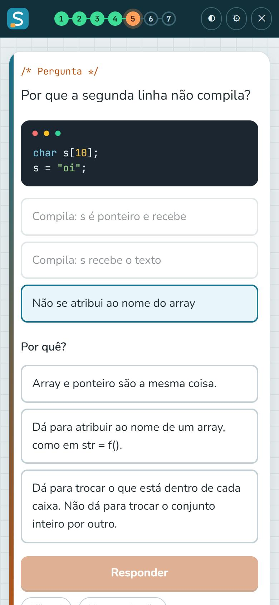
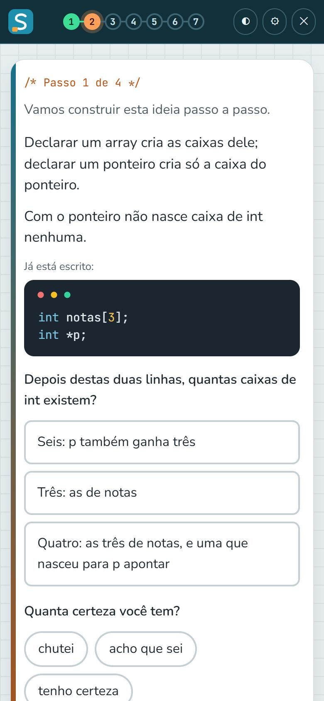
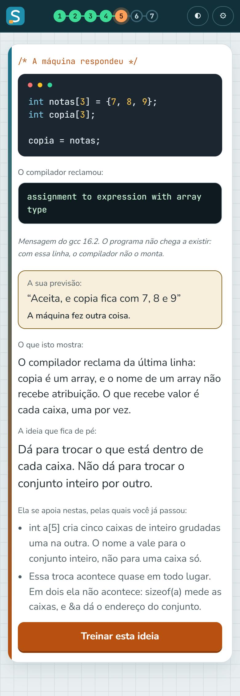

# 3. O sistema Structura

Este capítulo descreve o sistema na versão de 19/11/2026: o domínio que ele ensina (3.1); a forma como diagnostica cada estudante (3.2); o percurso que oferece a partir do diagnóstico (3.3); as três peças de conteúdo que sustentam esse percurso, que são a escada de passos (3.4), a demonstração com previsão (3.5) e a cena que anima a revisão de cada premissa (3.6); o registro da sessão (3.7); e a interface (3.8). A
arquitetura de software está resumida em 3.9.

## 3.1 O domínio: premissas, concepções errôneas e questões

O conteúdo de ponteiros em C está organizado em 13 tópicos, da
declaração de variáveis ao ponteiro pendente por escopo (Quadro 3.1).
Cada tópico é um pequeno grafo de premissas: proposições curtas que o
estudante pode afirmar ou negar. As premissas de base são fatos que se
verificam olhando um programa ("`int notas[3]` cria três caixas de int
grudadas"); as de inferência decorrem de outras, que são o seu suporte
("então `notas[i]` é só outro jeito de escrever `*(notas + i)`"). Os 13
tópicos somam 79 premissas, e a ordem de cada tópico respeita o
suporte: nenhuma premissa vem antes de uma premissa que a sustenta.

**Quadro 3.1 — Os tópicos**

| Tópico | Título | Premissas |
| --- | --- | --- |
| kc_00 | Declaração de variáveis | 5 |
| kc_01 | Modelo de memória | 5 |
| kc_02 | O que é um ponteiro | 6 |
| kc_03 | Declaração e inicialização | 6 |
| kc_04 | Dereferência: & e * | 6 |
| kc_05 | Ponteiro NULL | 6 |
| kc_06 | Passagem por referência | 6 |
| kc_07 | Ponteiro e array | 7 |
| kc_08 | Alocação dinâmica | 6 |
| kc_09 | free() e ponteiro pendente | 8 |
| kc_10 | Ponteiro para ponteiro | 6 |
| kc_11 | Aritmética de ponteiros | 6 |
| kc_12 | Ponteiro pendente por escopo | 6 |

Cada concepção errônea do catálogo nega exatamente uma premissa. É o
que transforma "o estudante tem uma ideia errada" num endereço: a crença
de que "o ponteiro é o próprio dado: retornar o endereço de uma local
devolve a variável" nega a premissa do kc_12 segundo a qual retornar
`&local` copia o endereço, e não a caixa. O catálogo tem 61 concepções,
cada uma com procedência declarada; o Capítulo 4 trata dessa procedência.

O banco de questões tem 560 questões de múltipla escolha, distribuídas
pelas premissas, cada uma com um nível (do mais mecânico ao mais
conceitual) e um uso (entrada, diagnóstico ou treino). Toda alternativa
errada aponta a concepção errônea que a explicaria. É dessa ligação que o
diagnóstico tira a razão de cada resposta.

Cada premissa tem ainda uma explicação curta, com a premissa em linguagem simples e um exemplo em código animado pela cena da premissa (3.6), que a pessoa pode abrir a qualquer momento pelo botão "Ver a explicação".

## 3.2 O diagnóstico: resposta, razão e certeza

Cada premissa começa por uma pergunta de diagnóstico, numa tela só
(Figura 3.1). A pessoa marca a resposta, que pode trocar à vontade, e a confirma. Só então aparecem as razões possíveis (a certa é a premissa em linguagem simples, e as erradas são as concepções errôneas que as alternativas daquela questão apontam), e a resposta trava; por último
vem a certeza: "chutei", "acho que sei" ou "tenho certeza". A ordem é
deliberada. As razões dão pista de qual resposta combina com cada uma, e
quem pudesse voltar depois de lê-las trocaria a resposta para combinar
com a razão: o diagnóstico passaria a medir a leitura das razões, e não a
ideia com que a pessoa respondeu. A confirmação antes das razões deixa
corrigir um toque errado enquanto a resposta ainda não travou. Há também o botão "Não
sei", que é uma resposta legítima: obrigar a escolher fabricaria chute,
e com ele a lacuna vira dado observado, e não inferido.



A pergunta de abertura de cada premissa é, de preferência, uma questão
com código de nível intermediário: a que pede que a pessoa aplique a
ideia num trecho de programa. Questões que usam construções que nenhum
tópico ensinou até ali (laço, `struct`, variável global, entre outras)
ficam fora da trilha, para não cobrar o que não foi ensinado; nos 13
tópicos, todas as premissas abrem com uma questão de código.

Do cruzamento dos três sinais saem quatro caminhos (Quadro 3.2).

**Quadro 3.2 — A classificação e o caminho de cada caso**

| O que a pessoa fez | Situação | Caminho |
| --- | --- | --- |
| resposta certa, razão certa, "tenho certeza" | sabe | firme |
| certa sem certeza, certa pela razão errada, ou errada pela razão certa | acerto sem firmeza | reforço |
| "Não sei", ou errada com "chutei" | não sabe | lacuna |
| errada, pela razão de uma concepção errônea, com alguma certeza | acha que sabe | crença |

A certeza declarada, aqui, não mede o estado mental da pessoa: ela
escolhe o percurso. Quem erra dizendo "chutei" sabe que não sabe, e
recebe ensino; quem erra com convicção, pela razão de uma concepção
mapeada, recebe a demonstração que confronta aquela concepção. A escala
tem três pontos porque precisa caber num toque dentro do ritmo da
atividade, e o ponto do meio ("acho que sei") puxa sempre para o lado
conservador: não confirma um acerto, e não deixa de tratar uma crença.

## 3.3 A trilha: o percurso de um tópico

Uma sessão percorre um tópico, premissa por premissa, na ordem do grafo:

```
entrada → premissa 1 → premissa 2 → … → reconferência → fechamento
```

Cada premissa recebe no máximo um trabalho (o da lacuna ou o da crença), o que garante um teto para a duração da sessão. Os quatro
caminhos funcionam assim:

- **Firme.** Um retorno curto, que diz por que a resposta está certa (cada uma das 79 perguntas de abertura tem essa explicação escrita, para que o acerto também ensine) e, no ritmo "completo", uma segunda
  pergunta de outra natureza: depois de marcar, a pessoa escreve: é o passo de produzir mais alto da escada da premissa (3.4). Acertou, a
  premissa fecha como "já sabia". No ritmo "rápido", a resposta firme
  fecha sozinha.
- **Reforço.** Uma pergunta a mais, em outro formato. Certa e pela razão
  certa, a premissa fecha como "firmou"; senão, segue o trabalho que a
  nova resposta pedir.
- **Lacuna.** A pessoa sobe a escada da premissa: os passos guiados e um
  passo de prática, com retorno imediato a cada um. O passo errado mostra
  a correção, com a resposta certa, e a subida segue: ninguém fica preso num passo. Um dos passos guiados de cada escada tem, entre as
  alternativas, a concepção errônea da premissa dita com todas as letras,
  e pede a certeza (Figura 3.2): escolhida com convicção, ela abre a
  demonstração na hora, porque é o mesmo episódio da pergunta de
  abertura. A premissa
  fecha como "aprendeu agora" quando a pessoa acerta a pergunta seguinte;
  se erra, vem a revisão: duas ou três frases com a ideia e um trecho
  de código, animado pela cena da premissa (3.6).
- **Crença.** A tela "Você disse" repete a concepção que a pessoa
  sustentou e pede uma previsão: o que ela espera que o programa faça.
  A tela seguinte mostra o que a máquina fez (3.5). Depois vem o treino,
  com os passos de prática da escada; a premissa fecha como "corrigiu uma
  ideia" quando o treino fecha.



Depois de todas as premissas, a reconferência faz uma pergunta para
cada premissa trabalhada na sessão, ensinada ou corrigida, com outras premissas no meio. É o que separa "acertou logo depois de ler" de
"assimilou nesta sessão". A pergunta é escolhida nesta ordem: o passo em
que a pessoa tropeçou, na versão que ela não viu; um passo de produzir
ainda não visto; uma questão do banco ainda não usada, que pergunta
também a razão; e só então um passo já visto, com outros valores. Quando
a razão marcada na reconferência é a concepção que tinha sido corrigida,
o fechamento diz que "a ideia voltou".

O fechamento (Figura 3.3) resume a sessão em quatro blocos (as ideias erradas encontradas e se foram corrigidas; as lacunas, e em que passos; o que já estava firme; e o que ficou em aberto) e, abaixo, mostra a lista de
premissas com o resultado de cada uma e o acesso à explicação. O passo em
que a pessoa tropeçou aparece pelo nome dele, uma frase curta com a
ideia do passo, e não pelo enunciado do exercício.


## 3.4 A escada de passos

Cada premissa tem uma escada: uma sequência ordenada de passos, do
mais mecânico até a ideia. Os passos guiados trazem uma ou duas
frases curtas e um exercício pequeno; os de prática trazem só o
exercício. A mesma escada serve para ensinar (a subida de quem não sabe),
para treinar (depois da demonstração) e para reconferir (no fim).

Os exercícios têm cinco formas: tocar a parte de uma linha de código,
montar uma linha a partir de peças, escolher entre alternativas,
completar a lacuna de uma linha, e digitar a saída de um trecho.
Cada passo tem duas versões (a segunda, com outros valores, é a que a reconferência usa), e todo erro previsto tem retorno próprio, que diz o
que faltou e mostra o certo. As 79 premissas somam 402 passos (244
guiados e 158 de prática) e 804 versões. As formas se distribuem como no
Quadro 3.3.

**Quadro 3.3 — Os passos, por forma**

| Forma | Passos |
| --- | --- |
| escolher | 190 |
| digitar | 140 |
| montar | 37 |
| completar | 30 |
| tocar | 5 |

O texto de cada passo segue uma régua escrita, contra a qual o conteúdo
foi revisado: um passo, uma ideia, com no máximo duas frases curtas antes
do exercício; só usa o que um passo anterior já ensinou, neste tópico ou
num anterior; primeiro o que se faz, depois a ideia; código que um
iniciante escreveria; cada passo muda uma coisa só em relação ao
anterior; e a analogia, quando há, vem depois do passo, nunca no lugar
dele. Cada tópico trabalha as mesmas duas ou três variáveis do começo ao fim (no kc_10, por exemplo, `idade` guarda um número, `p` o endereço de `idade` e `pp` o endereço de `p`), de modo que a declaração cresce e o
cenário não muda.

## 3.5 A demonstração com previsão

Para cada concepção errônea de cada tópico há uma demonstração: um
programa curto, de no máximo nove linhas, escrito com os nomes do cenário
do tópico, e uma pergunta de previsão com duas alternativas: a que a máquina confirma e a que a concepção errônea espera (Figuras 3.4a e
3.4b). A pessoa prevê; depois vê o que aconteceu, e uma frase diz o que
aquilo mostra e qual premissa fica de pé. As 61 concepções do catálogo dão
80 demonstrações porque 14 delas aparecem em mais de um tópico (a de que o ponteiro é o próprio dado, por exemplo, em quatro), e cada tópico tem a
sua, com o cenário dele.




O que a máquina "respondeu" é de dois tipos. Em 41 das 80 demonstrações é
a saída do programa: no kc_11, por exemplo, quem acredita que a
aritmética de ponteiros conta bytes prevê lixo para `*(p + 3)` sem
`sizeof`, e vê sair o valor de `notas[3]`. Nas outras 39 é o que o
compilador diz do programa: no kc_12, quem acredita que `static` muda
o escopo de uma variável prevê que o nome `n` passe a valer fora da
função, e vê o compilador reclamar que `n` não foi declarado ali.
Algumas dessas mensagens só aparecem com uma opção a mais do compilador (o analisador de fluxo, `-fanalyzer`, por exemplo, que aponta o bloco de memória pedido e nunca devolvido), e as opções permitidas formam uma
lista fechada.

Quando o resultado depende do ambiente (o número de um endereço de memória, o tamanho de um tipo, o comportamento particular de um compilador), a demonstração traz uma nota de ambiente que diz isso
com todas as letras. No kc_12, o gcc 16.2 devolve `NULL` no lugar do
endereço de uma variável local que deixou de existir; a demonstração que
usa esse fato diz que é uma escolha do gcc, e que o padrão da linguagem
não define aquele valor.

Toda demonstração foi conferida por compilador antes de entrar no
sistema: a saída tem de ser a que o texto afirma, e a mensagem tem de sair
de uma linha só, porque a tela diz "o compilador reclamou desta linha", e a
mesma mensagem saindo de duas seria a demonstração dizer menos do que
aconteceu. O Capítulo 5 descreve essa conferência.

## 3.6 A cena

A revisão de cada premissa tem uma cena: o trecho de código dela
animado linha a linha (Figura 3.5). A linha que roda fica marcada no
código, e um palco ao lado mostra o que ela fez: a caixa que nasce, o
valor que entra e o que sai, o ponteiro com o seu bilhete, o que vai
para a tela. São 79 cenas, uma por premissa.


Os personagens são poucos e vêm da mesma analogia em todos os tópicos. A
caixa é a variável: uma etiqueta com o nome, o tipo escrito em cima e
o valor numa bolinha dentro, com um "?" enquanto não há valor. O
ponteiro é uma caixa que guarda um bilhete, "→ idade", com uma seta
até a caixa apontada; o `NULL` é o bilhete que diz `NULL`, sem seta. A
fileira é o array: as caixinhas lado a lado, com o índice embaixo, ou
em linhas e colunas na matriz, e a caixinha que a linha lê ou escreve
fica marcada; o texto entra como uma fileira de `char` com o `'\0'` no
fim. A bancada é a função enquanto roda: um andar próprio, com a
primeira linha da função por título, onde nascem as caixas dela, que
somem quando ela termina, menos a marcada `static`, que fica. E o
bloco alugado é o que o `malloc` pede: ele mora num andar à parte, o
monte, com a placa "alugado", e depois do `free` fica apagado, com a
placa "devolvido".

A cena anda sozinha, um passo por segundo e pouco, com os botões
Pausar, Passo e Rever. Quem pediu ao sistema operacional menos movimento
vê a cena já no estado final, com o passo a passo nos botões. Cada passo tem uma frase, escrita embaixo do palco e lida pelos leitores de tela; por exemplo: "Linha 3: guarda 21 em idade; o 20 que estava lá sai." Em
tela de computador, a cena fica ao lado do texto da revisão; no celular,
embaixo.

A cena é dado, e não desenho: cada uma é uma lista de passos, um por
linha executada, com as ações daquela linha (criar uma caixa, guardar um
valor, apontar, chamar e voltar de uma função, alugar e devolver um
bloco). Por ser dado, ela é conferida contra o compilador como o resto
do conteúdo (Capítulo 5): o palco nunca mostra um valor que o programa
não tem.

## 3.7 O registro e a retomada

Tudo o que a pessoa faz é gravado num registro só de acréscimo, um evento
por linha: a resposta, a razão, a certeza, o tempo, a previsão e se ela
coincidiu com a concepção errônea, os passos errados, a reconferência.
Nada é apagado ou reescrito. A sessão inteira pode ser reconstruída
reexecutando as entradas gravadas: é assim que o sistema retoma uma
sessão depois de o servidor reiniciar, e é por isso que tudo o que muda o
caminho da sessão é entrada registrada. Como uma mudança nas regras faria
as mesmas respostas caírem em telas diferentes, a primeira linha de cada
sessão diz a versão das regras com que ela começou, e uma sessão de outra
versão não é refeita: a pessoa vê uma mensagem, e não uma tela errada.

A identificação é por um código de participante, opcional e sem nenhum
dado pessoal; o mesmo código retoma a sessão no mesmo tópico. Sem código,
é o navegador que guarda o número da sessão: quem fecha a página e reabre
o tópico volta à tela em que estava.

No meio da sessão, o botão Sair do topo oferece duas saídas. "Guardar
e sair" volta à página dos tópicos, e a sessão continua de onde parou
quando o tópico é reaberto. Não há o que gravar a mais, porque cada
resposta já está no registro. "Cancelar a sessão", depois de uma
confirmação, faz o tópico recomeçar do zero. Também o cancelamento não
apaga nada: o registro ganha uma linha dizendo que a sessão foi
cancelada, e daí em diante ela não é mais retomada: nem pelo número, nem
pelo código, nem refeita depois de um reinício do servidor.

## 3.8 A interface

A interface foi desenhada para parecer um ambiente de programação, em
dois temas: o escuro, inspirado num editor de código à noite (Figura
3.6), e o claro, com o topo escuro como a barra de um terminal (Figuras
3.1 a 3.4). O tema é
escolhido antes de a página ser desenhada (o do sistema operacional, ou o que a pessoa escolheu da última vez), e pode ser trocado por um botão
no topo. Todos os pares de texto sobre fundo passam na razão de contraste
de 4,5:1 que o critério 1.4.3 da WCAG 2.1, no nível AA, exige para texto
comum (W3C, 2025), nos dois temas; quem pediu ao sistema operacional
menos movimento não vê animação.

O código aparece numa moldura de editor, com cores por categoria
(palavras-chave, números, textos, comentários, nomes de função); a saída
do programa e a mensagem do compilador aparecem numa moldura de terminal,
sem cores de código. O topo da trilha mostra o tópico e uma parada por
premissa, numerada, com o estado de cada uma (feita, em aberto, agora ou ainda não), também dito em texto para leitores de tela, além dos botões
de tema, de ajustes (o ritmo) e de sair. Em tela de celular os botões
ficam só com o desenho, para que as oito paradas do kc_09 caibam em
360 px de largura.

A página inicial desenha o caminho dos 13 tópicos como a trilha de
um jogo (Figura 3.6): dez tópicos em fila, do kc_00 ao kc_09 (com o kc_01, modelo de memória, depois do kc_06 e do kc_07), abrindo-se em três no fim (kc_10, kc_11 e kc_12, que não dependem um do
outro). A ordem é
sugerida, e não imposta: todos os tópicos ficam abertos, e um teste
confere que cada tópico vem depois dos seus pré-requisitos. Cada parada
mostra o seu estado (já feito, próximo, em andamento ou aberto) e o andamento do tópico ("3 de 6"), e o próximo sugerido aparece num cartão
acima do caminho.


As fontes são livres (licença OFL) e estão guardadas no próprio projeto:
nenhuma página carrega nada de outro endereço.

## 3.9 Arquitetura

O sistema é escrito em Python, com um servidor HTTP (FastAPI) e páginas
em HTML, CSS e JavaScript sem dependências externas. O conteúdo (premissas, concepções errôneas, questões e escadas) fica em arquivos
YAML, separados do código: acrescentar ou corrigir conteúdo não exige
mexer no motor. O motor da trilha é uma função pura do estado da sessão e
da entrada da pessoa, que devolve a próxima tela; é isso que torna a
sessão reexecutável a partir do registro. Um portal monta os 13 tópicos
num só servidor, que roda num contêiner Docker na própria máquina do
laboratório, sem depender de serviço externo.
