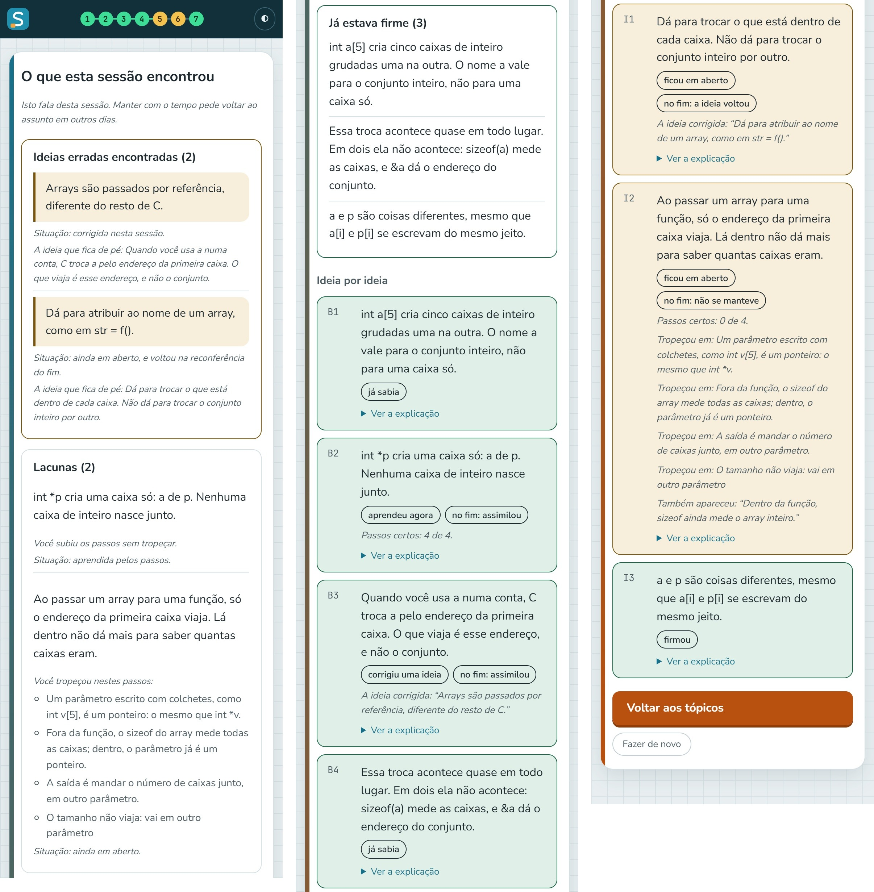
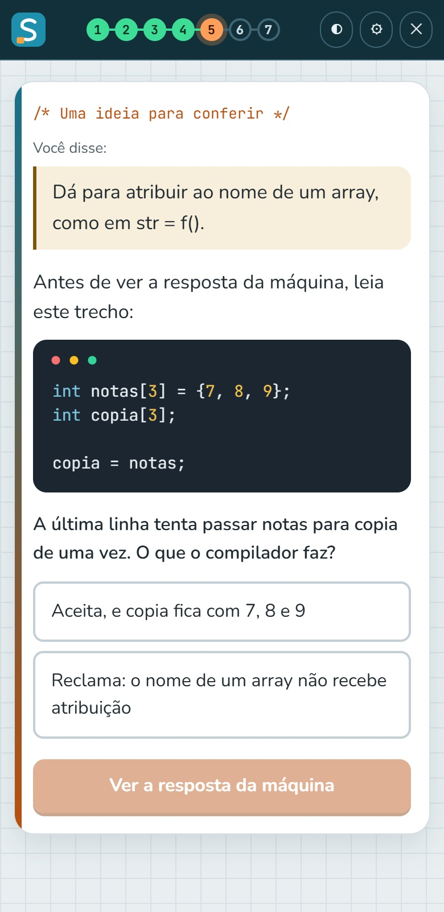
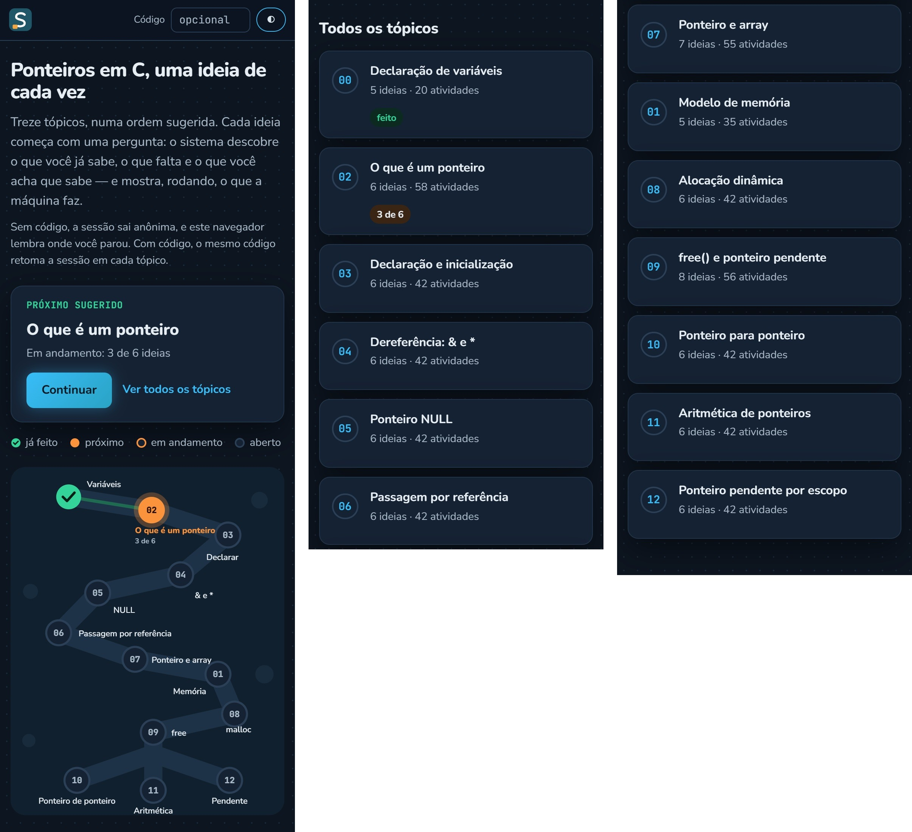

# 3. O sistema Structura

Esta seção descreve o sistema na versão de 19/11/2026. São apresentados o domínio de ensino (Seção 3.1), o diagnóstico de cada estudante (Seção 3.2), o percurso oferecido a partir do diagnóstico (Seção 3.3) e os três tipos de conteúdo que sustentam esse percurso: a escada de passos (Seção 3.4), a demonstração com previsão (Seção 3.5) e a cena que anima a revisão de cada premissa (Seção 3.6). Em seguida, descrevem-se o registro da sessão (Seção 3.7), a interface (Seção 3.8) e a arquitetura de software (Seção 3.9).

## 3.1 Domínio: premissas, concepções errôneas e questões

O conteúdo de ponteiros em C está organizado em 13 tópicos, identificados pelos códigos kc_00 a kc_12, que vão da declaração de variáveis ao ponteiro pendente por escopo (Quadro 3.1). Cada tópico é representado por um grafo de premissas, proposições curtas que o estudante pode afirmar ou negar. As premissas de base são fatos verificáveis pela observação de um programa (por exemplo, "`int notas[3]` cria três caixas de int grudadas"); as premissas de inferência decorrem de outras, que constituem o seu suporte (por exemplo, "então `notas[i]` é só outro jeito de escrever `*(notas + i)`"). Os 13 tópicos somam 79 premissas, e a ordem de apresentação em cada tópico respeita a relação de suporte: nenhuma premissa é apresentada antes daquelas que a sustentam. Em cada tópico, as premissas de base são identificadas pela letra B e as de inferência pela letra I, seguidas de um número de ordem (por exemplo, B1 e I3).

**Quadro 3.1 — Tópicos do domínio e número de premissas**

| Tópico | Título | Premissas |
| --- | --- | --- |
| kc_00 | Declaração de variáveis | 5 |
| kc_01 | Modelo de memória | 5 |
| kc_02 | O que é um ponteiro | 6 |
| kc_03 | Declaração e inicialização | 6 |
| kc_04 | Dereferência: & e * | 6 |
| kc_05 | Ponteiro NULL | 6 |
| kc_06 | Passagem por referência | 6 |
| kc_07 | Ponteiro e array | 7 |
| kc_08 | Alocação dinâmica | 6 |
| kc_09 | free() e ponteiro pendente | 8 |
| kc_10 | Ponteiro para ponteiro | 6 |
| kc_11 | Aritmética de ponteiros | 6 |
| kc_12 | Ponteiro pendente por escopo | 6 |

Cada concepção errônea do catálogo nega exatamente uma premissa. Essa associação permite localizar a concepção no grafo: a crença de que "o ponteiro é o próprio dado: retornar o endereço de uma local devolve a variável", por exemplo, nega a premissa do tópico kc_12 segundo a qual retornar `&local` copia o endereço, e não a variável. O catálogo tem 61 concepções, cada uma com procedência declarada; a Seção 4 trata dessa procedência.

O banco de questões tem 560 questões de múltipla escolha, distribuídas pelas premissas, cada uma com um nível (do mais mecânico ao mais conceitual) e uma finalidade (entrada, diagnóstico ou treino). Toda alternativa incorreta indica a concepção errônea que a explicaria, e é dessa associação que o diagnóstico obtém a razão de cada resposta.

Cada premissa dispõe ainda de uma explicação curta, composta pelo enunciado da premissa em linguagem simples e por um exemplo em código, animado pela cena da premissa (Seção 3.6). A explicação pode ser consultada a qualquer momento por meio do botão "Ver a explicação".

## 3.2 Diagnóstico: resposta, razão e certeza

Cada premissa tem início com uma pergunta de diagnóstico, apresentada em uma única tela (Figura 3.1). A pessoa seleciona a resposta, que pode ser alterada livremente, e a confirma. Somente após a confirmação são exibidas as razões possíveis, e a resposta deixa de poder ser alterada. A razão correta corresponde ao enunciado da premissa em linguagem simples, e as incorretas correspondem às concepções errôneas indicadas pelas alternativas da questão. Por último, a pessoa declara a certeza: "chutei", "acho que sei" ou "tenho certeza". Essa ordem é deliberada. As razões sugerem qual resposta é compatível com cada uma delas; se a resposta pudesse ser alterada depois de lidas as razões, a pessoa tenderia a ajustá-la à razão escolhida, e o diagnóstico passaria a medir a leitura das razões, e não a ideia com que a pessoa respondeu. A confirmação anterior à exibição das razões permite corrigir uma seleção acidental enquanto a resposta ainda pode ser alterada. A tela oferece também o botão "Não sei", tratado como resposta legítima: a obrigatoriedade de escolher uma alternativa induziria respostas ao acaso, ao passo que, com esse botão, a lacuna de conhecimento torna-se um dado observado, e não inferido.


A pergunta de abertura de cada premissa é, preferencialmente, uma questão com código de nível intermediário, que requer a aplicação do conceito a um trecho de programa. As questões que utilizam construções ainda não ensinadas por nenhum tópico até aquele ponto (laço, `struct` e variável global, entre outras) são excluídas da trilha, para que não se exija o que não foi ensinado. Nos 13 tópicos, todas as premissas têm como abertura uma questão com código.

A combinação dos três sinais define quatro caminhos (Quadro 3.2).

**Quadro 3.2 — Classificação da resposta e caminho correspondente**

| Resposta, razão e certeza | Situação | Caminho |
| --- | --- | --- |
| resposta correta, razão correta e "tenho certeza" | sabe | firme |
| resposta correta sem certeza, correta pela razão incorreta ou incorreta pela razão correta | acerto sem firmeza ou sinais divergentes | reforço |
| "Não sei", ou resposta incorreta com "chutei" | não sabe | lacuna |
| resposta incorreta, pela razão de uma concepção errônea, com alguma certeza | sustenta uma concepção errônea | crença |

A situação atribuída a cada resposta é uma hipótese diagnóstica: o sistema identifica um padrão de resposta compatível com determinada situação, e não constata o que a pessoa pensa. A correspondência entre a hipótese e a concepção que a pessoa de fato sustenta depende de validação com participantes (Seção 7.1).

O caminho de reforço reúne dois tipos de caso: o acerto pela razão correta sem a certeza máxima e a divergência entre os sinais, que ocorre quando a resposta é correta pela razão incorreta ou incorreta pela razão correta. Na divergência, um único episódio não é considerado suficiente para atribuir uma concepção errônea à pessoa. O sistema apresenta uma pergunta adicional e somente conduz à demonstração se a mesma concepção for indicada novamente ou se a nova resposta for incorreta, com alguma certeza, pela razão de uma concepção errônea (Seção 3.3).

Nesse desenho, a certeza declarada não mede o estado mental da pessoa: sua função é selecionar o percurso. Quem erra e declara "chutei" reconhece que não sabe e recebe ensino; quem erra com convicção, pela razão de uma concepção errônea mapeada, recebe a demonstração que confronta essa concepção. A escala tem três pontos porque deve caber em uma única interação no ritmo da atividade, e o ponto intermediário ("acho que sei") é sempre tratado de forma conservadora: não confirma um acerto e não dispensa o tratamento de uma concepção errônea.

## 3.3 Trilha: percurso de um tópico

Uma sessão percorre um tópico, premissa por premissa, na ordem definida pelo grafo:

```
entrada → premissa 1 → premissa 2 → … → reconferência → fechamento
```

Cada premissa recebe no máximo uma intervenção (a correspondente à lacuna ou a correspondente à crença), o que estabelece um limite superior para a extensão da sessão, medida em número de telas. A premissa cuja intervenção não é concluída dentro desse limite é encerrada com o resultado "em aberto". Os quatro caminhos e os resultados correspondentes são descritos a seguir.

- **Firme.** O sistema apresenta um retorno curto, que explica por que a resposta está correta (cada uma das 79 perguntas de abertura dispõe dessa explicação, de modo que também o acerto contribua para o aprendizado) e, no ritmo "completo", uma segunda pergunta, de outra natureza, na qual a pessoa deve produzir a resposta, e não apenas indicá-la entre alternativas: trata-se do passo de produção de nível mais alto da escada da premissa (Seção 3.4). Em caso de acerto, a premissa é encerrada com o resultado "já sabia". No ritmo "rápido", a resposta firme encerra a premissa diretamente.
- **Reforço.** O sistema apresenta uma pergunta adicional, em outro formato. Se a resposta for correta e pela razão correta, a premissa é encerrada com o resultado "firmou"; caso contrário, segue-se a intervenção indicada pela nova resposta.
- **Lacuna.** A pessoa percorre a escada da premissa: os passos guiados e um passo de prática, com retorno imediato a cada um. Diante de um erro, o passo exibe a correção, com a resposta correta, e o percurso prossegue, de modo que a pessoa não fica retida em nenhum passo. Um dos passos guiados de cada escada inclui, entre as alternativas, a concepção errônea da premissa enunciada explicitamente e solicita a certeza (Figura 3.2); se essa alternativa for escolhida com convicção, a demonstração é apresentada imediatamente, pois se trata do mesmo tipo de episódio da pergunta de abertura. A premissa é encerrada com o resultado "aprendeu agora" quando a pessoa acerta a pergunta seguinte; em caso de erro, é apresentada a revisão, composta de duas ou três frases com o conceito e de um trecho de código animado pela cena da premissa (Seção 3.6).
- **Crença.** A tela "Você disse" reapresenta a concepção sustentada pela pessoa e solicita uma previsão do comportamento do programa. A tela seguinte exibe o resultado da execução (Seção 3.5). Em seguida, é realizado o treino, com os passos de prática da escada, e a premissa é encerrada com o resultado "corrigiu uma ideia" quando a pessoa acerta duas perguntas de treino consecutivas, em no máximo três perguntas.


Concluídas todas as premissas, a reconferência apresenta uma pergunta para cada premissa trabalhada na sessão, isto é, ensinada ou corrigida, depois de a pessoa ter respondido a outras premissas. Esse intervalo permite distinguir a assimilação na sessão do acerto obtido logo após a leitura. A pergunta é selecionada na seguinte ordem de preferência: o passo em que a pessoa errou, na versão que ela ainda não viu; um passo de produção ainda não visto; uma questão do banco ainda não utilizada, que solicita também a razão; e, somente em último caso, um passo já visto, com outros valores. Quando a razão indicada na reconferência corresponde à concepção que havia sido corrigida, o fechamento informa que "a ideia voltou".

O fechamento (Figura 3.3) resume a sessão em quatro blocos (as concepções errôneas encontradas e a situação de cada uma; as lacunas e os passos em que ocorreram; o que já estava firme; e o que permaneceu em aberto) e, abaixo deles, exibe a lista de premissas com o resultado de cada uma e o acesso à respectiva explicação. O passo em que a pessoa errou é identificado pelo seu nome, uma frase curta que enuncia a ideia do passo, e não pelo enunciado do exercício.



## 3.4 Escada de passos

Cada premissa dispõe de uma escada, isto é, uma sequência ordenada de passos que parte da operação mais mecânica e chega ao conceito. Os passos guiados contêm uma ou duas frases curtas e um exercício breve; os passos de prática contêm apenas o exercício. A mesma escada é utilizada para ensinar (no percurso de quem não sabe), para treinar (após a demonstração) e para reconferir (ao final do tópico).

Os exercícios assumem cinco formas: tocar a parte indicada de uma linha de código, montar uma linha a partir de peças, escolher entre alternativas, completar a lacuna de uma linha e digitar a saída de um trecho. Nas formas montar, completar e digitar, a pessoa produz a resposta, e os passos correspondentes são denominados passos de produção; nas formas tocar e escolher, ela apenas indica a resposta. Cada passo possui duas versões (a segunda, com outros valores, é utilizada na reconferência), e todo erro previsto tem retorno próprio, que indica o que faltou e apresenta a resposta correta. As 79 premissas somam 402 passos (244 guiados e 158 de prática) e 804 versões. A distribuição dos passos por forma é apresentada no Quadro 3.3.

**Quadro 3.3 — Passos por forma de exercício**

| Forma | Passos |
| --- | --- |
| escolher | 190 |
| digitar | 140 |
| montar | 37 |
| completar | 30 |
| tocar | 5 |

O texto de cada passo obedece a um conjunto de regras de redação, contra o qual o conteúdo foi revisado: cada passo trata de uma única ideia, com no máximo duas frases curtas antes do exercício; utiliza apenas o que já foi ensinado em um passo anterior, do mesmo tópico ou de tópico anterior; apresenta primeiro a operação e depois o conceito; emprega código que um iniciante escreveria; altera um único elemento em relação ao passo anterior; e, quando há analogia, ela é apresentada depois do passo, e nunca em substituição a ele. Cada tópico utiliza as mesmas duas ou três variáveis do início ao fim (no tópico kc_10, por exemplo, `idade` armazena um número, `p` armazena o endereço de `idade` e `pp` armazena o endereço de `p`), de modo que as declarações se acumulam sem que o cenário mude.

## 3.5 Demonstração com previsão

Para cada concepção errônea de cada tópico há uma demonstração, composta de um programa curto, de no máximo nove linhas, escrito com os nomes do cenário do tópico, e de uma pergunta de previsão com duas alternativas: a que a execução confirma e a que decorre da concepção errônea (Figuras 3.4a e 3.4b). A pessoa registra a previsão e, em seguida, observa o resultado; uma frase indica o que o resultado demonstra e qual premissa permanece válida. As 61 concepções do catálogo resultam em 80 demonstrações porque 14 delas aparecem em mais de um tópico (a de que o ponteiro é o próprio dado, por exemplo, aparece em quatro), e cada tópico possui a sua demonstração, com o respectivo cenário.




O resultado exibido é de dois tipos. Em 41 das 80 demonstrações, trata-se da saída do programa: no tópico kc_11, por exemplo, quem acredita que a aritmética de ponteiros opera em bytes prevê a impressão de um valor arbitrário para `*(p + 3)` sem o uso de `sizeof`, e observa a impressão do valor de `notas[3]`. Nas outras 39, trata-se da mensagem emitida pelo compilador: no tópico kc_12, quem acredita que `static` altera o escopo de uma variável prevê que o nome `n` passe a ser válido fora da função, e observa a mensagem de que `n` não foi declarado naquele ponto. Algumas dessas mensagens são emitidas apenas com uma opção adicional do compilador (por exemplo, o analisador de fluxo, `-fanalyzer`, que aponta o bloco de memória alocado e nunca liberado), e as opções permitidas formam uma lista fechada.

Quando o resultado depende do ambiente (o valor numérico de um endereço de memória, o tamanho de um tipo ou o comportamento particular de um compilador), a demonstração inclui uma nota de ambiente que explicita essa dependência. No tópico kc_12, por exemplo, o compilador *GNU Compiler Collection* (gcc), na versão 16.2, devolve `NULL` no lugar do endereço de uma variável local que deixou de existir; a demonstração que utiliza esse comportamento informa que se trata de uma escolha do gcc e que o padrão da linguagem não define aquele valor: segundo o padrão, o valor de um ponteiro torna-se indeterminado quando o objeto para o qual ele aponta chega ao fim do seu tempo de vida (ISO/IEC, 2011, p. 38).

Toda demonstração foi conferida por compilador antes de ser incorporada ao sistema: a saída deve ser a que o texto afirma, e a mensagem deve ser emitida para uma única linha, pois a tela informa que "o compilador reclamou desta linha", e a emissão da mesma mensagem para duas linhas tornaria essa afirmação incompleta. A Seção 5 descreve essa conferência.

## 3.6 Cena

A revisão de cada premissa inclui uma cena, na qual o trecho de código correspondente é animado linha a linha (Figura 3.5). A linha em execução é destacada no código, e uma área ao lado, denominada palco, representa o efeito dessa linha: a criação de uma variável, o valor armazenado e o valor substituído, o ponteiro e o endereço que ele armazena, e a saída enviada à tela. São 79 cenas, uma por premissa.


Os elementos visuais são poucos e derivam de uma mesma analogia, utilizada em todos os tópicos. A caixa representa a variável: uma etiqueta com o nome, o tipo indicado acima e o valor em um círculo interno, substituído por "?" enquanto a variável não tem valor atribuído. O ponteiro é representado por uma caixa que guarda um bilhete, "→ idade", com uma seta até a caixa apontada; o valor `NULL` é representado por um bilhete com o texto `NULL`, sem seta. A fileira representa o array: caixas menores dispostas lado a lado, com o índice abaixo de cada uma, ou em linhas e colunas no caso de matrizes, com destaque para a posição lida ou escrita pela linha em execução; uma cadeia de caracteres é representada como uma fileira de `char` terminada por `'\0'`. A bancada representa a função em execução: uma região própria, cujo título é a primeira linha da função, na qual são criadas as suas variáveis locais, que desaparecem quando a função termina, com exceção das declaradas como `static`, que permanecem. Por fim, o bloco alugado representa a memória obtida por `malloc`: é exibido em uma região separada, o monte, com a indicação "alugado" e, após a chamada a `free`, aparece esmaecido, com a indicação "devolvido".

A cena avança automaticamente, a pouco mais de um segundo por passo, e dispõe dos botões Pausar, Passo e Rever. Para quem configurou o sistema operacional para reduzir movimento, a cena é exibida já no estado final, e a execução passo a passo fica disponível por meio dos botões. Cada passo é acompanhado de uma frase, exibida abaixo do palco e lida pelos leitores de tela, como em "Linha 3: guarda 21 em idade; o 20 que estava lá sai." Em telas de computador, a cena é exibida ao lado do texto da revisão; em telas de celular, abaixo dele.

A cena é definida como dado, e não como desenho: cada cena é uma lista de passos, um por linha executada, com as ações correspondentes àquela linha (criar uma caixa, armazenar um valor, apontar, chamar uma função e retornar dela, alocar e liberar um bloco). Por ser definida como dado, a cena é conferida contra o compilador da mesma forma que o restante do conteúdo (Seção 5), o que assegura que o palco não exiba um valor diferente do que o programa possui.

## 3.7 Registro e retomada da sessão

Todas as ações da pessoa são gravadas em um registro somente de acréscimo, com um evento por linha: a resposta, a razão, a certeza, o tempo, a previsão e a sua coincidência com a concepção errônea, os passos errados e a reconferência. Nenhum evento é apagado ou reescrito. A sessão pode ser inteiramente reconstruída pela reexecução das entradas gravadas; é dessa forma que o sistema retoma uma sessão após a reinicialização do servidor, e é por essa razão que tudo o que altera o percurso da sessão é tratado como entrada registrada. Como uma alteração nas regras faria com que as mesmas respostas conduzissem a telas diferentes, a primeira linha de cada sessão registra a versão das regras com que ela foi iniciada, e uma sessão de outra versão não é reconstruída: nesse caso, a pessoa recebe uma mensagem informativa.

A identificação é feita por um código de participante, opcional e sem nenhum dado pessoal; o mesmo código permite retomar a sessão no mesmo tópico. Na ausência de código, o navegador armazena o identificador da sessão, de modo que a pessoa que fecha a página e reabre o tópico retorna à tela em que se encontrava.

Durante a sessão, o botão Sair, localizado na barra superior, oferece duas opções. A opção "Guardar e sair" retorna à página dos tópicos, e a sessão é retomada do ponto em que foi interrompida quando o tópico é reaberto; nenhuma gravação adicional é necessária, pois cada resposta já consta do registro. A opção "Cancelar a sessão", após confirmação, faz com que o tópico seja reiniciado. O cancelamento também não apaga dados: o registro recebe uma linha que indica o cancelamento, e a sessão deixa de ser retomada, seja pelo identificador, seja pelo código, seja pela reconstrução após a reinicialização do servidor.

## 3.8 Interface

A interface foi projetada para se assemelhar a um ambiente de programação e dispõe de dois temas: o escuro, inspirado em um editor de código (Figura 3.6), e o claro, com a barra superior escura, à semelhança de um terminal (Figuras 3.1 a 3.4). O tema é definido antes da renderização da página (o do sistema operacional ou o escolhido pela pessoa no último acesso) e pode ser alterado por um botão na barra superior. Em ambos os temas, todos os pares de cor de texto e de fundo atendem à razão de contraste de 4,5:1 exigida para texto comum pelo critério de sucesso 1.4.3 das *Web Content Accessibility Guidelines* (WCAG), versão 2.1, no nível AA (W3C, 2025). Para quem configurou o sistema operacional para reduzir movimento, as animações não são exibidas.

O código é exibido em uma moldura de editor, com cores por categoria (palavras-chave, números, cadeias de caracteres, comentários e nomes de função); a saída do programa e a mensagem do compilador são exibidas em uma moldura de terminal, sem realce de sintaxe. A barra superior da trilha exibe o tópico e um marcador numerado por premissa, com o estado de cada uma (concluída, em aberto, atual ou ainda não iniciada), também descrito em texto para leitores de tela, além dos botões de tema, de ajustes (o ritmo) e de saída. Em telas de celular, os botões exibem apenas o ícone, para que os oito marcadores do tópico kc_09 caibam em 360 px de largura.

A página inicial representa o caminho dos 13 tópicos como a trilha de um jogo (Figura 3.6): dez tópicos em sequência, do kc_00 ao kc_09 (com o kc_01, modelo de memória, posicionado depois do kc_06 e do kc_07), seguidos de três ramos finais (kc_10, kc_11 e kc_12, que não dependem uns dos outros). A ordem é sugerida, e não imposta: todos os tópicos permanecem acessíveis, e um teste automatizado confere que cada tópico é posicionado depois dos seus pré-requisitos. Cada marcador exibe o estado do tópico (concluído, próximo, em andamento ou disponível) e o seu andamento (por exemplo, "3 de 6"), e o próximo tópico sugerido é exibido em um cartão acima do caminho.



As fontes tipográficas utilizadas têm licença livre, a *SIL Open Font License* (OFL), e estão armazenadas no próprio projeto, de modo que nenhuma página carrega recursos de endereços externos.

## 3.9 Arquitetura

O sistema é implementado em Python, com um servidor *Hypertext Transfer Protocol* (HTTP), construído com a biblioteca FastAPI, e páginas em *HyperText Markup Language* (HTML), *Cascading Style Sheets* (CSS) e JavaScript, sem dependências externas. O conteúdo (premissas, concepções errôneas, questões e escadas) é mantido em arquivos no formato *YAML Ain't Markup Language* (YAML), separados do código, de modo que a inclusão ou a correção de conteúdo não exige alterações no motor. O motor da trilha é uma função pura do estado da sessão e da entrada da pessoa, que devolve a tela seguinte; essa propriedade torna a sessão reexecutável a partir do registro. Um portal reúne os 13 tópicos em um único servidor, executado em um contêiner Docker na própria máquina do laboratório, sem dependência de serviços externos.
