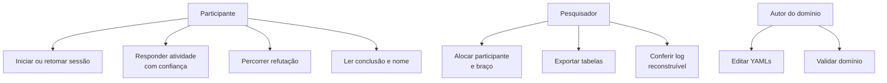

# Requisitos

O que o sistema faz hoje, com o estado de cada requisito, e o que a
reconstrução da sessão acrescenta. Os códigos RF e RNF são os da
especificação v1.0 e aparecem citados no próprio código.

## Atores e casos de uso

Três atores, e um deles não é humano.

| Ator | Quem é | O que faz no sistema |
| --- | --- | --- |
| Participante | estudante de graduação | responde atividades, percorre o percurso, lê conclusões |
| Pesquisador | autor do TCC | aloca o código e o braço, zera o banco, exporta, roda o validador |
| Autor do domínio | também você, noutro papel | escreve grafos, crenças e atividades nos YAMLs |

Separar os dois últimos importa: o autor do domínio mexe em conteúdo e
**nunca** em código. É essa separação que permite dizer, no TCC, que o motor
não sabe nada sobre C.

**Caso de uso principal, passo a passo.** *Responder uma atividade que
revela uma crença:* o sistema escolhe a atividade pelo estado do vetor e
pelo nível; o participante escolhe a alternativa e declara a confiança; o
sistema registra a resposta e, se o distrator estiver mapeado e a confiança
não for "chutei", levanta a hipótese de crença, marca o nó negado como
errado e entra na correção. Senão, segue para a próxima atividade ou para a
construção do que falta.

**Fluxos alternativos que o sistema precisa cobrir**, e cobre: a aba fecha
no meio (retomada pelo mesmo código), o aluno recusa o mesmo passo três
vezes (fechamento em aberto), o domínio não tem atividade para fechar o
tópico (fechamento em aberto), o participante erra a atividade de fechamento
(nova rodada de correção, sem descartar o que já foi confirmado).

## Requisitos funcionais

Os códigos abaixo são citados no próprio código-fonte, módulo por módulo —
quem lê `engine/session.py` encontra `RF08`, `RF10`, `RF11`. Isso é
rastreabilidade de requisito e vale ser dito na defesa.

| Código | Requisito | Onde vive | Estado |
| --- | --- | --- | --- |
| RF01 | Carregar o domínio declarativo e recusar YAML inconsistente na carga | `engine/loader.py` | feito |
| RF02 | Coletar confiança declarada antes de submeter a resposta | `web/`, `api/` | feito |
| RF03 | Manter o vetor de estado de cada premissa | `engine/model.py` | feito |
| RF04 | Distinguir premissa ausente de premissa errada pela confiança | `engine/model.py` | feito |
| RF05 | Extrair a crença do distrator escolhido, sem inferir do erro | `engine/model.py` | feito |
| RF07 | Pular no percurso o nó já sustentado na sessão, mesmo vindo de outro tópico | `engine/socratic.py` | feito |
| RF08 | Confronto visual antes do percurso quando a crença nega um nó-base | `engine/session.py` | feito, limitado pelos diagramas que existem |
| RF09 | Regressão controlada: reformula, retrocede um passo, encerra na terceira | `engine/socratic.py` | feito |
| RF10 | Nomeação tardia: o termo técnico só na conclusão | `engine/session.py` | feito |
| RF11 | Encerrar o tópico com o mesmo invariante em código novo | `engine/selector.py` | feito |
| RF13 | Log append-only como única fonte de verdade | `store/events.py` | feito |
| RF14 | Estado da sessão serializável e reconstruível do log | `store/projections.py` | feito |
| RF16 | Encadear tópicos na ordem de prerequisito | `engine/selector.py` | feito |
| RF17 | Feedback em três etapas: validação, contradição, reconstrução | `engine/feedback.py` | feito |

Três requisitos entraram depois da especificação v1.0, ao longo do uso, e
ainda não têm código na numeração original: **gradação por nível** (as
atividades sobem um degrau por vez), **desafio adaptativo** (quem acerta com
certeza pula o básico) e **sondagem** (no nó da crença, o aluno escolhe em
vez de confirmar). Eles precisam ser numerados e incorporados à
especificação — hoje existem em código e em teste, não no documento de
requisitos.

## Requisitos não funcionais

| Código | Requisito | Como é garantido |
| --- | --- | --- |
| RNF01 | Nenhum termo do domínio de C fora de `domain/` | teste que varre o código procurando vocabulário de C |
| RNF02 | Determinismo: mesmo estado, mesma decisão | empates resolvidos pela ordem do YAML; embaralhamento por `sha256(sessão, atividade)`, nunca `random` |
| RNF03 | Resposta em até 200 ms | conexão por requisição, SQLite local, sem rede |
| RNF04 | Toda sessão reconstruível só do log | `tools/replay --verify` compara o estado derivado com a reprojeção |
| RNF05 | Funcionar offline | nenhuma fonte, folha ou script de fora; nada de rede em sessão |
| RNF06 | Retomar de onde parou após fechar a aba | o estado é reconstruído do log a cada requisição |

**Por que RNF01 e RNF02 são os que mais valem no TCC.** O primeiro é o que
sustenta a afirmação de que trocar de domínio não exige tocar no motor — e
ele é verificado por teste, não por promessa. O segundo é o que permite
dizer que duas sessões em estados iguais recebem a mesma atividade: sem
isso, nenhuma comparação entre participantes se sustenta.

**Privacidade e ética, tratadas como requisito.** O banco não guarda nome,
matrícula nem e-mail: só o código anônimo (P01…). O consentimento é coluna
obrigatória — participante sem consentimento registrado simplesmente não
entra no banco, e a escrita falha. As sessões simuladas vão para banco
separado e o simulador **recusa** gravar em arquivo chamado `structura*.db`.

## Regras de negócio

São nove, e cada uma nasceu de um problema concreto. Elas são o
comportamento do sistema; quem entende estas nove entende o Structura.

1. **Confiança roteia.** Errou chutando → lacuna. Errou sem chutar, em
   distrator mapeado → hipótese de crença. Acertou → premissa sustentada.
2. **Crença mostrada com convicção não é apagada por acerto posterior.** Se
   o aluno erra a atividade fácil e acerta a difícil sobre o mesmo nó, a
   crença continua ativa e ele passa pela refutação. Sem esta regra, a
   graduação de nível apagaria a evidência justamente de quem a mostrou.
3. **Chute nunca vira crença.** Escolher um distrator no chute entra no log
   como dado bruto, mas não aciona refutação — seria refutar algo que a
   pessoa não pensa, e inflaria a frequência de cada crença na população.
4. **O nível sobe um degrau por vez.** Dentro de um tópico, a apresentação
   nunca pula do nível 1 para o 3, mesmo quando a atividade difícil é a que
   toca a fronteira do conhecimento.
5. **Quem acerta com certeza é desafiado.** A cada dois acertos seguidos com
   a confiança mais alta, o nível mínimo sobe um degrau (até o 3). Qualquer
   erro ou hesitação zera a sequência e devolve ao nível 1.
6. **Largura antes de repetição.** O tópico apresenta no máximo três
   atividades e tem mais do que isso; entre as candidatas do mesmo nível,
   ganha a que oferece uma crença ainda não perguntada.
7. **O percurso pula o que já está de pé**, inclusive premissa sustentada
   num tópico anterior.
8. **Três recusas no mesmo nó encerram o tópico** — com a conclusão na tela,
   nunca em silêncio.
9. **A atividade que fecha o tópico repergunta a crença refutada**, noutra
   superfície.

Duas dessas regras são decisões suas de pesquisa, não consequências
técnicas — a 2 e a 5 —, e o TCC deve apresentá-las como escolhas
justificadas, com a alternativa que foi descartada.

## O que a reconstrução exige

Oito requisitos novos. Cada um tem critério de aceitação testável — é assim
que dá para dizer "pronto" sem discussão.

| # | Requisito | Critério de aceitação |
| --- | --- | --- |
| RF18 | A sessão é dividida em unidades de um tópico, começadas e encerradas por unidade | uma unidade completa cabe em 10 telas e termina sem depender das outras |
| RF19 | Cada unidade abre com telas de ensino da premissa, com figura | toda unidade apresenta ao menos duas telas de ensino antes da primeira atividade |
| RF20 | Toda resposta recebe retorno imediato de acerto ou erro, com uma linha de porquê | nenhuma atividade avança sem informar o resultado |
| RF21 | Quando a resposta levanta hipótese de crença, o retorno é neutro e leva à refutação | o texto exibido não contém a resposta correta nem a explicação |
| RF22 | O percurso de refutação tem teto de passos | nenhuma sequência passa de 5 passos sem tela de fechamento parcial |
| RF23 | O reteste da crença acontece ao fim da sessão, não na tela seguinte | há ao menos uma unidade entre a refutação e o reteste |
| RF24 | A unidade fecha com o mapa do que o aluno construiu | a tela mostra os nós sustentados, o nó refutado e o progresso |
| RF25 | Formatos de atividade variados por unidade | uma unidade não apresenta três atividades do mesmo formato |

**Fora de escopo agora, e com motivo:** perfil persistente entre sessões,
ranking, gamificação com pontos, uso remoto sem pesquisador, e o braço de
explicação direta como condição de comparação — este último continua
implementado e testado, só não é usado nesta coleta.

**A rastreabilidade que falta.** Nenhum desses oito está na especificação
v1.0, e a gradação, o desafio e a sondagem também não. Antes da escrita do
TCC, a especificação precisa de uma versão 1.1 que os incorpore, senão o
capítulo de requisitos vai descrever um sistema que não é o que rodou na
coleta.
